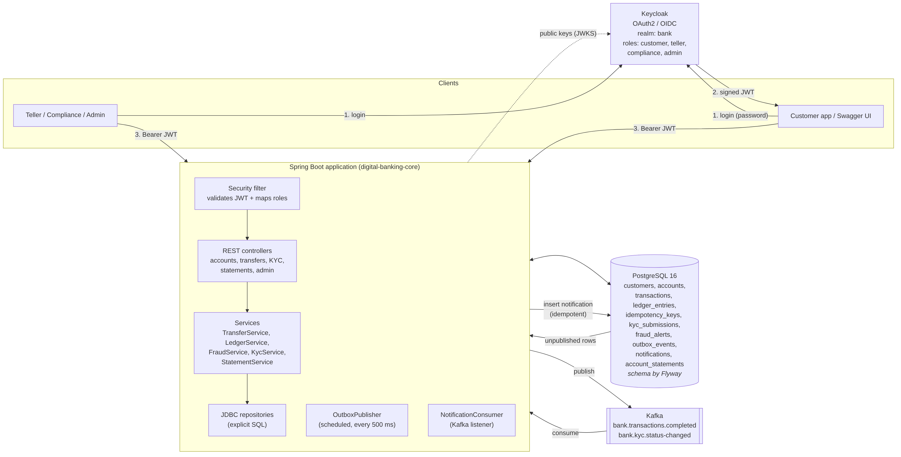

# Digital Banking Core Platform

The engine of a bank: **accounts, atomic money transfers, a double-entry ledger that always balances, and identity (KYC) checks.**

Backend track project. Stack: **Spring Boot 3.5 (Java 21), PostgreSQL 16, Flyway, Kafka, Keycloak (OAuth2), OpenAPI/Swagger.**

| Milestone from the brief | Where it lives |
|---|---|
| 1. Double-entry bookkeeping | `LedgerService`, `V1__core_schema.sql` (balance trigger), [docs/CODE_WALKTHROUGH.md](docs/CODE_WALKTHROUGH.md) §3 |
| 2. Schema + Flyway | `src/main/resources/db/migration/V1..V4`, [ER diagram](docs/er-diagram.png) |
| 3. Account & transfer APIs, atomic, idempotent | `TransferTransactions`, `AccountController`, `TransferController` |
| 4. Keycloak OAuth2 + roles | `SecurityConfig`, `keycloak/bank-realm.json` |
| 5. Kafka events (transfer completed) | `EventPublisher` (outbox), `OutboxPublisher`, `NotificationConsumer` |
| 6. KYC workflow + fraud rules | `KycService`, `FraudService` |
| 7. Concurrency tests, OpenAPI, monthly statements | `src/test/java`, springdoc, `StatementService` |

## Deliverables

| Deliverable from the brief | Where |
|---|---|
| Working demo | run it with [docs/SETUP_GUIDE.md](docs/SETUP_GUIDE.md); `scripts/demo.sh` plays the whole story. Screen-recording plan: [docs/VIDEO_SCRIPT.md](docs/VIDEO_SCRIPT.md) |
| GitHub repository, README, setup instructions | this repository |
| Architecture diagram, data and API documentation | [docs/architecture.png](docs/architecture.png), [docs/er-diagram.png](docs/er-diagram.png), [docs/transfer-sequence.png](docs/transfer-sequence.png), [docs/CODE_WALKTHROUGH.md](docs/CODE_WALKTHROUGH.md), live OpenAPI at `/swagger-ui.html` |
| Test results and numbers | [Tests and results](#tests-and-results) below, `verification/` |
| 10-minute presentation | [presentation/Digital_Banking_Core.pptx](presentation/Digital_Banking_Core.pptx) (12 slides; source `presentation/build_deck.js`) |
| Explainer video | [video/Digital_Banking_Core_explainer.mp4](video/Digital_Banking_Core_explainer.mp4) (captioned slides, no voice) and the narration script in [docs/VIDEO_SCRIPT.md](docs/VIDEO_SCRIPT.md). Add your own recorded link here: `<VIDEO LINK>` |
| Individual reflection | write your own in `docs/REFLECTION.md` (what you learned, what you owned) |

## Architecture



- Request path of one transfer: [docs/transfer-sequence.png](docs/transfer-sequence.png)
- Database model: [docs/er-diagram.png](docs/er-diagram.png)

## Quick start

Full step-by-step instructions for a fresh laptop (Windows / macOS / Linux) are in **[docs/SETUP_GUIDE.md](docs/SETUP_GUIDE.md)**. The short version, once Java 21, Maven and Docker are installed:

```bash
docker compose up -d            # PostgreSQL, Kafka, Keycloak (wait ~60 s for Keycloak)
mvn spring-boot:run             # starts the API on http://localhost:8080
bash scripts/demo.sh            # in another terminal: runs the whole story end to end
```

Then open **http://localhost:8080/swagger-ui.html** (interactive API docs). Get a token with `scripts/get-token.sh alice` and paste it into *Authorize*.

Demo users (all have the password `password`):

| User | Role | Can do |
|---|---|---|
| `alice`, `bob` | customer | own profile, KYC, accounts, transfers, statements |
| `tina` | teller | cash deposit / withdrawal, view any account |
| `carl` | compliance | review KYC, see fraud alerts |
| `admin1` | admin | everything, plus reconciliation and statement job |

## What the API offers

| Method & path | Role | Purpose |
|---|---|---|
| `GET /api/v1/customers/me` | customer | my profile (auto-created on first call) |
| `POST /api/v1/kyc` · `GET /api/v1/kyc/me` | customer | submit KYC documents · see status |
| `GET /api/v1/admin/kyc?status=` | compliance, admin | review queue |
| `POST /api/v1/admin/kyc/{id}/approve` · `/reject` | compliance, admin | decide (reject needs a reason) |
| `POST /api/v1/accounts` · `GET /api/v1/accounts` | customer | open account (KYC approved only) · list mine |
| `GET /api/v1/accounts/{id}` · `/entries` | owner, teller, admin | account and its ledger lines |
| `POST /api/v1/accounts/{id}/deposit` · `/withdraw` | teller, admin | cash operations (idempotent) |
| `POST /api/v1/transfers` | customer | **atomic, idempotent transfer** (header `Idempotency-Key`) |
| `GET /api/v1/transfers/{id}` | participant, teller, admin | one transaction |
| `GET /api/v1/accounts/{id}/statements/{yyyy-MM}` (+ `/csv`) | owner, teller, admin | monthly statement |
| `POST /api/v1/admin/statements/generate?period=` | admin | run the month-end snapshot job now |
| `GET /api/v1/admin/reconciliation` | admin | **proof that the books balance** |
| `GET /api/v1/admin/fraud-alerts` | compliance, admin | blocked-transfer log |
| `GET /api/v1/notifications` | customer | notifications created from Kafka events |

Errors are RFC 7807 JSON with a stable `code` (`INSUFFICIENT_FUNDS`, `IDEMPOTENCY_KEY_REUSED`, `KYC_REQUIRED`, `FRAUD_VELOCITY`, ...).

## Key design decisions

1. **Double-entry, enforced by the database.** Each transfer writes one `transactions` row and two `ledger_entries` (`-amount`, `+amount`). A *deferred constraint trigger* rejects any transaction whose entries do not sum to zero at COMMIT, and another trigger makes the ledger **append-only**. Even a bug in the Java code cannot unbalance the books.
2. **Atomicity.** One database transaction covers: idempotency key, balance check, ledger lines, balance update, outbox event. All or nothing.
3. **No lost updates, no deadlocks.** Both account rows are locked with `SELECT … ORDER BY id FOR NO KEY UPDATE`. Every transfer locks in the same global order, so opposite transfers (A→B and B→A) wait for each other instead of deadlocking.
4. **Idempotency.** `(caller, Idempotency-Key)` is the primary key of `idempotency_keys` and is inserted in the *same* transaction as the money movement. A retry returns the original result (HTTP 200 + `Idempotent-Replay: true`); the same key with a different body is refused (422); a failed request leaves no key behind so it can be retried. Concurrent duplicates serialise on the unique key.
5. **Transactional outbox for Kafka.** Events are written to `outbox_events` inside the money transaction and published to Kafka by a background job. No event for a rolled-back transfer, no lost event for a committed one. Consumers de-duplicate on `eventId` (Kafka is at-least-once).
6. **Fraud rules run under the row lock**, so two parallel requests cannot both slip under a limit they would jointly break. The alert is saved *after* the rollback so it is not lost, without needing a second DB connection.
7. **Plain JDBC (`JdbcClient`) instead of JPA** on the money path: every SQL statement and lock is explicit and reviewable.
8. **Money is `NUMERIC(19,2)` / `BigDecimal`**, never floating point.

## Tests and results

**Java integration tests (32 tests, `mvn test`)** run against a real PostgreSQL 16 started by Testcontainers:

| Class | What it proves |
|---|---|
| `TransferConcurrencyTest` (7) | 30 parallel transfers cannot overdraw; 20 parallel requests with one idempotency key charge once; opposite transfers never deadlock; fan-in is exact |
| `LedgerInvariantTest` (4) | unbalanced ledger rejected at COMMIT; ledger append-only; overdraft impossible even by raw SQL; reconciliation healthy after activity |
| `FraudRulesTest` (4) | max-amount, daily-limit, velocity rules; alert survives rollback |
| `KycWorkflowTest` (6) | submit/approve/reject/resubmit, four-eyes rule, under-18 check, KYC gate on transfers |
| `StatementAndOutboxTest` (4) | statement arithmetic, privacy, outbox written only on commit |
| `ApiSecurityTest` (7) | 401/403/404 behaviour, JSON error format, idempotent replay over HTTP |

**Database-level verification (already executed, real PostgreSQL 16)** — `verification/concurrency_check.py` replays the exact SQL sequence of a transfer from parallel connections. Output saved in [`verification/concurrency_check_output.txt`](verification/concurrency_check_output.txt):

```
[PASS] 30 parallel transfers of 100 from a 1000 balance: exactly 10 succeed, 20 insufficient funds
[PASS] 20 parallel requests with the SAME idempotency key: 1 fresh, 19 replays, one transaction, debited once
[PASS] same idempotency key with a different amount is rejected
[PASS] a rolled-back transfer leaves no idempotency key, so the same key can be retried
[PASS] 40 simultaneous opposite transfers A<->B: no deadlock, no errors, money conserved
[PASS] 25 senders pay one receiver at once: receiver has exactly 1000
[PASS] database refuses an unbalanced ledger at COMMIT (trigger)
[PASS] database refuses UPDATE on the ledger (append-only trigger)
THROUGHPUT: 3000 transfers, 16 threads, 40 account pairs -> 228 transfers/s (p50=68 ms, p95=98 ms, p99=114 ms)
[PASS] FINAL RECONCILIATION: ledger_sum=0.00, unbalanced_tx=0, balance_mismatches=0
```

> **Honest scope note.** The throughput figure comes from the Python replay on a small shared sandbox, opening a new connection per transfer. It shows the database design behaves; it is **not** a benchmark of the Spring application. Re-measure on your own machine and put your numbers in the presentation (see `docs/SETUP_GUIDE.md`, "Measuring performance").

## Known limitations / next steps

- **Single hot row:** every cash deposit/withdrawal locks the one `SYS-CASH-NPR` clearing account, so cash operations are serialised. Fix: shard clearing accounts per branch.
- **Single currency (NPR).** Cross-currency transfers are rejected with `CURRENCY_MISMATCH`; FX would need rates and a conversion ledger account.
- **No reversals/refunds yet.** The schema has a `REVERSED` status; the correcting-entry flow is not implemented.
- **KYC stores document *metadata* only**, not document images (would go to object storage).
- **Statements** are JSON and CSV; PDF rendering is a next step.
- **Fraud rules are static thresholds**; real systems add scoring models (the PaySim / IBM AML datasets in the brief are good training data).
- **Spring Boot 3.5** was chosen deliberately for ecosystem stability; its open-source support ended on 30 Jun 2026, so the next step is moving to Boot 4.x.
- **Keycloak realm is demo-grade** (public client, password grant, passwords = `password`). Production needs the authorization-code + PKCE flow, real secrets and TLS.

## Repository layout

```
src/main/java/com/bankcore/
  config/       security, OpenAPI, Kafka topics, typed settings
  domain/       Customer, Account, BankTransaction, LedgerEntry, ... (immutable records)
  repository/   explicit-SQL JDBC repositories
  service/      TransferService/TransferTransactions, LedgerService, FraudService, KycService, StatementService, ...
  events/       outbox writer, outbox -> Kafka publisher, Kafka consumer
  web/          REST controllers, DTOs, error handler
  exception/    business errors with stable codes
src/main/resources/db/migration/   Flyway V1..V4
src/test/java/                      integration + concurrency tests
keycloak/bank-realm.json            realm, roles, demo users
scripts/                            get-token.sh, demo.sh
verification/                       DB-level concurrency check + saved output
docs/                               setup guide, code walkthrough, diagrams, video script
presentation/                       the PowerPoint deck and the script that builds it
video/                              narration, captioned explainer video and its build script
```
